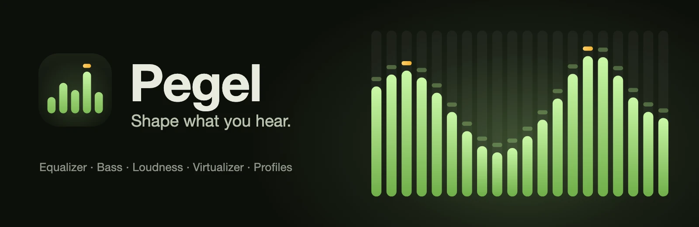
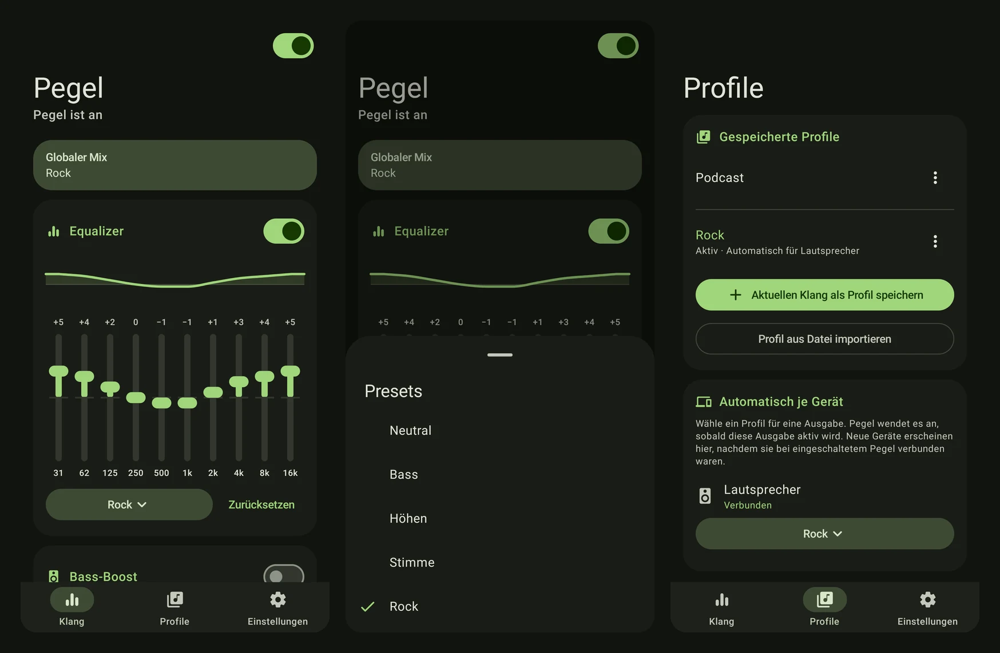
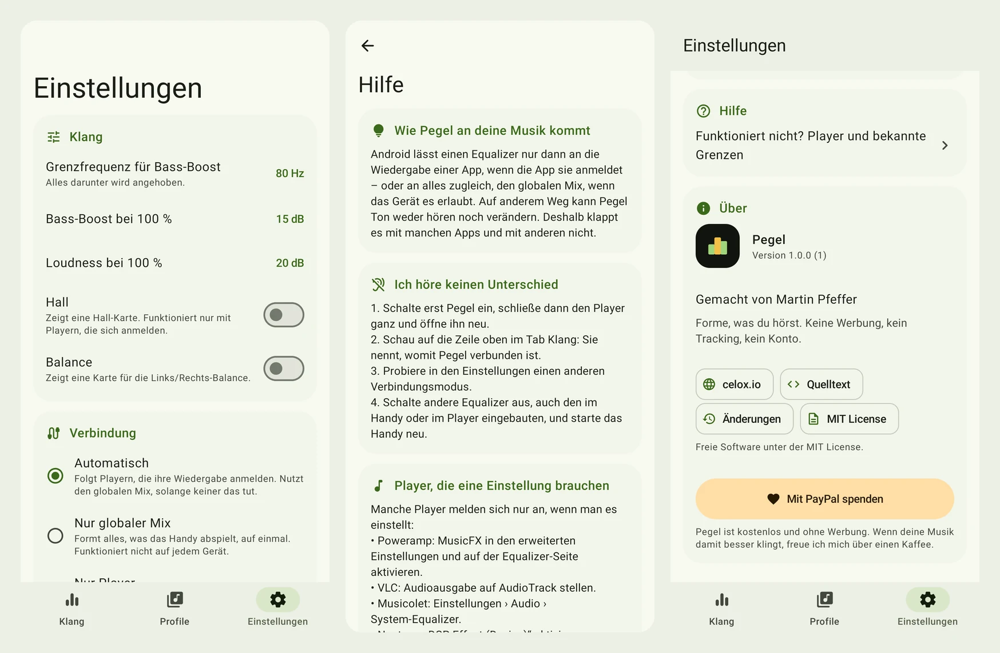

<div align="center">

<a href="https://pegel.celox.io"></a>

# 🎚️ Pegel

**Forme, was du hörst.** — ein systemweiter Equalizer für Android: zehn Bänder, Bass, Loudness, Virtualizer und Profile, die deinen Kopfhörern folgen. Quelloffen, ohne Werbung, ohne Tracking.

<p>
  <a href="https://pegel.celox.io/download"></a>
  &nbsp;
  <a href="https://www.paypal.com/donate/?business=martin.pfeffer@celox.io&currency_code=EUR&item_name=Pegel"></a>
</p>

<h3>👉 <a href="https://pegel.celox.io">pegel.celox.io</a> — die Produktseite: Download, Prüfsummen, FAQ in fünf Sprachen</h3>

<!-- Generated by scripts/update-badges.py — never edit these four by hand (ReadmeBadgesTest). -->
[](https://github.com/pepperonas/pegel/releases/latest)
[](app/src/test)
[](app/src/main/java)
[](app/src/test)

</div>

<!-- Project status -->
<p align="center">
  <a href="https://github.com/pepperonas/pegel/releases/latest"></a>
  <a href="https://github.com/pepperonas/pegel/releases/latest"></a>
  <a href="https://github.com/pepperonas/pegel/releases"></a>
  <a href="https://github.com/pepperonas/pegel/actions/workflows/tests.yml"></a>
  <a href="https://github.com/pepperonas/pegel/actions/workflows/release.yml"></a>
</p>
<p align="center">
  <a href="https://github.com/pepperonas/pegel/commits/main"></a>
  <a href="https://github.com/pepperonas/pegel/issues"></a>
  
  
</p>

<!-- Tech stack -->
<p align="center">
  
  
  
  
  
  
</p>
<p align="center">
  
  
  
  
  
</p>

<!-- Promises -->
<p align="center">
  
  
  
  
  
  
  <a href="LICENSE"></a>
  <a href="CHANGELOG.md"></a>
  
  <a href="https://www.paypal.com/donate/?business=martin.pfeffer@celox.io&currency_code=EUR&item_name=Pegel"></a>
</p>

[English](README.md) · **Deutsch**

Pegel hängt Androids eigene Audio-Effekte an die Musik, die du abspielst, und lässt dich sie formen:
ein Equalizer mit zehn Bändern, Bass-Boost, Loudness, ein Virtualizer, auf Wunsch Hall und Balance.
Speichere das Ergebnis als Profil und binde es an eine Ausgabe — deine Ohrhörer bekommen ihren Klang
in dem Moment, in dem sie sich verbinden.

## Screenshots

<p align="center">
  
</p>
<p align="center">
  
</p>

## Download

Die neueste signierte APK gibt es unter **[pegel.celox.io/download](https://pegel.celox.io/download)** oder unter **[Releases](https://github.com/pepperonas/pegel/releases/latest)**. Jedes Release bringt eine
`SHA256SUMS.txt` mit; vergleiche sie vor dem Installieren:

```bash
sha256sum -c SHA256SUMS.txt
```

Pegel ist nicht bei Google Play. Android fragt einmal, ob dein Browser oder Dateimanager Apps
installieren darf. Danach aktualisiert Pegel sich selbst: Eine Karte auf dem ersten Bildschirm
bietet jede neue Version an und installiert sie, nachdem ihre Prüfsumme geprüft ist.

## Was Pegel kann

| | |
|---|---|
| **Equalizer** | Zehn Bänder (31 Hz – 16 kHz), ±12 dB in 0,5-dB-Schritten, eine Kurve über den Reglern, 13 Presets, eigene Presets |
| **Bass-Boost** | Stärke 0–100 %; Grenzfrequenz 10–150 Hz und Maximum 5–30 dB in den Einstellungen |
| **Loudness** | Stärke 0–100 %; Maximum 5–30 dB in den Einstellungen. Die Verstärkung läuft in einen Limiter, Anhebungen werden also dichter statt zu übersteuern |
| **Virtualizer** | Stärke 0–100 % |
| **Hall** | Kleiner, mittlerer, großer Raum · mittlerer, großer Saal · Platte (zuschaltbare Karte) |
| **Balance** | Links/rechts, mit Zurücksetzen (zuschaltbare Karte) |
| **Profile** | Der ganze Klang unter einem Namen: laden, speichern, umbenennen, löschen, Änderungen verwerfen |
| **Automatisch je Gerät** | Ein Profil je Ausgabe: Lautsprecher, Kabel, USB, jedes Bluetooth-Gerät |
| **Sicherung** | Alles in einer JSON-Datei; einzelne Profile als `.pegel`-Datei |

Alles ist kostenlos. Es gibt keine „Pro“-Version.

## So funktioniert es

Android gibt einer Equalizer-App genau zwei Wege an den Ton, und Pegel nutzt beide:

1. **Player, die sich anmelden.** Ein Musikplayer kann verkünden: „Ich spiele auf Audio-Sitzung 42.“
   Pegel hängt seine Effekte dann an diese Sitzung. Das ist der verlässliche Weg.
2. **Der globale Mix.** Effekte lassen sich auch an Sitzung 0 hängen — alles, was das Handy abspielt,
   gemischt. Ob das erlaubt ist, hängt vom Gerät ab.

Unter *Einstellungen › Verbindung* legst du fest, was genutzt wird: **Automatisch** (Player, wenn es
welche gibt, sonst der globale Mix), **Nur globaler Mix** oder **Nur Player**. Die Zeile oben im Tab
Klang sagt immer, womit Pegel gerade verbunden ist.

Alle Effekte einer Sitzung laufen in einer einzigen
[`DynamicsProcessing`](https://developer.android.com/reference/android/media/audiofx/DynamicsProcessing)-Instanz —
der Post-Equalizer trägt die zehn Bänder, ein Pre-Equalizer-Band den Bass-Boost, die
Eingangsverstärkung je Kanal die Balance und die Loudness-Verstärkung, und ein Limiter fängt ab, was all das über Vollaussteuerung drückt — dazu Androids `Virtualizer` und
`PresetReverb`. Pegel greift selbst keinen Ton ab, nimmt nichts auf und rechnet nichts; es stellt nur
Effekte ein, die das System ausführt.

## Was geht – und was nicht

Pegel kann nur Ton formen, der es auf einem der beiden Wege erreicht. Das ist eine Grenze von Android,
nicht dieser App, und kein Equalizer ohne Root kommt daran vorbei.

- **Geht:** Player, die ihre Sitzung anmelden (viele Musikplayer tun das, manche brauchen eine
  Einstellung — siehe Hilfe in der App), und alles, was dein Gerät durch den globalen Mix lässt.
- **Braucht eventuell eine Einstellung im Player:** Poweramp, VLC, Musicolet, Neutron, BlackPlayer,
  Deezer. Suche in den Audio-Einstellungen des Players nach „System-Equalizer“.
- **Geht nicht:** Apps, die ihre Wiedergabe weder anmelden noch über den globalen Mix abspielen —
  meist Apps mit eigener Audio-Engine oder Kopierschutz.
- **Ein hart beendeter Player** meldet sich nie ab. Pegel nennt ihn dann weiter; tippe in der Statuszeile auf *Trennen*, um zum globalen Mix zurückzukehren.
- **Hall** funktioniert nur auf der eigenen Sitzung eines Players, nicht im globalen Mix. Die Karte
  sagt das.
- **Bluetooth:** Ändert sich der Klang am Lautsprecher, aber nicht über Bluetooth, schalte in den
  Entwickleroptionen *Bluetooth-A2DP-Hardware-Offload deaktivieren* ein und starte neu.
- **Andere Equalizer** (auch der im Handy eingebaute) streiten sich um dieselbe Sitzung. Nutze einen.
- **Android 9 oder neuer.** `DynamicsProcessing` gibt es davor nicht.

Die App hat dafür eine Hilfeseite: *Einstellungen › Hilfe*.

## Profile & Geräte

Ein Profil ist ein Schnappschuss aller Karten im Tab Klang. Änderst du etwas, zeigt das Profil
„(geändert)“, bis du speicherst oder verwirfst.

Im Tab Profile bekommt jede Ausgabe, die Pegel gesehen hat, eine Zeile: Wähle das Profil, das sie
nutzen soll. Wird diese Ausgabe aktiv, wendet Pegel das Profil an und sagt es dir in einer kurzen
Benachrichtigung. Ausgaben werden an Art und Namen erkannt — das braucht keine Bluetooth-Berechtigung,
kostet aber, dass sich zwei Geräte desselben Modells einen Eintrag teilen.

## Sicherung

*Einstellungen › Sicherung* schreibt alle Profile, Presets und Einstellungen über Androids Dateiauswahl
in eine JSON-Datei und liest sie wieder ein. Eine Wiederherstellung ersetzt den Bestand (nach
Rückfrage) und schaltet Pegel nie ein oder aus. Eine Datei, die keine Pegel-Sicherung ist oder aus
einer neueren Version stammt, wird abgelehnt und ändert nichts; ein beschädigter Eintrag in einer Sicherung wird übersprungen, und der Dialog nennt vor dem Ersetzen, wie viele Profile und Presets die Datei enthält.

## Berechtigungen

| Berechtigung | Wozu |
|---|---|
| `MODIFY_AUDIO_SETTINGS` | Effekte an den globalen Mix hängen |
| `FOREGROUND_SERVICE`, `FOREGROUND_SERVICE_SPECIAL_USE` | Die Effekte am Leben halten, solange Pegel an ist |
| `POST_NOTIFICATIONS` | Die Benachrichtigung dieses Dienstes: womit Pegel verbunden ist, und „Ausschalten“ |
| `RECEIVE_BOOT_COMPLETED` | Nach einem Neustart wieder starten, falls Pegel an war |
| `REQUEST_IGNORE_BATTERY_OPTIMIZATIONS` | Die Ausnahme in den Einstellungen anbieten, damit das Handy Pegel nicht beendet |
| `INTERNET` | Nur die Update-Prüfung und das Update, das sie lädt; ist die Prüfung ausgeschaltet, geht nichts ins Netz |
| `REQUEST_INSTALL_PACKAGES` | Das geladene, per Prüfsumme geprüfte Update an Androids Installer übergeben |
| `ACCESS_NETWORK_STATE`, `WAKE_LOCK` | Kommen mit WorkManager, der diese Update-Prüfung plant: „ausführen, wenn eine Verbindung da ist“ |

Kein Mikrofon, kein Speicher, kein Bluetooth, kein Standort, keine Kontakte.

## Datenschutz

Pegel hat keine Werbung, keine Analyse, keine Absturzberichte und kein Konto. Profile und
Einstellungen bleiben auf dem Handy. Die App geht für genau eine Sache ins Netz, ihre eigenen Updates: Einmal
am Tag und beim Öffnen fragt sie `pegel.celox.io` nach der neuesten Version (GitHubs öffentliche API,
falls die Seite nicht antwortet) — eine schlichte Anfrage ohne Kennung — und lädt das Update, wenn du
auf *Aktualisieren* tippst. *Einstellungen › Updates* schaltet die Prüfung aus; dann stellt die App
gar keine Anfrage mehr.

## Bauen

```bash
git clone https://github.com/pepperonas/pegel.git && cd pegel
./gradlew :app:assembleDebug        # APK → app/build/outputs/apk/debug/
```

Nötig sind JDK 17 und das Android SDK (Plattform 35); Android Studio legt `local.properties` an.

### Tests

```bash
./gradlew :app:testDebugUnitTest    # JVM + Robolectric
./gradlew :app:lintDebug
```

Die Audio-Logik ist reines Kotlin hinter einer Schnittstelle (`EffectChain`). Sitzungsverwaltung,
Umrechnung von Reglern in Effekt-Parameter, Profilspeicher und Sicherungsformat sind deshalb ohne
Gerät getestet. Drift-Wächter halten die READMEs, die Changelogs, die beiden Sprachen und die
Berechtigungsliste ehrlich.

## Projektstruktur

```
app/src/main/java/io/celox/pegel/
  audio/      SoundState, Presets, ChainPlan, EffectEngine — und AndroidEffectChain,
              die einzige Datei, die android.media.audiofx anfasst
  data/       Room (Profile, Presets, Geräte), DataStore-Einstellungen, SoundRepository, Sicherungsformat
  device/     Ausgabe-Erkennung, Automatik je Gerät
  service/    Vordergrunddienst, Sitzungs- und Boot-Empfänger, Benachrichtigungen
  ui/         sound · profiles · settings · about · theme (Material 3 Expressive)
  update/     Update-Prüfung und Update in der App
```

## Ein Release erstellen

1. `versionCode` und `versionName` in `app/build.gradle.kts` erhöhen.
2. Einen datierten Abschnitt `## [X.Y.Z] - YYYY-MM-DD` in `CHANGELOG.md` **und** `CHANGELOG.de.md` anlegen.
3. `python3 scripts/update-badges.py`
4. Committen, pushen, dann `git tag vX.Y.Z && git push origin vX.Y.Z`.

Der Workflow lässt die Tests laufen, baut die signierte APK, prüft das Signaturzertifikat gegen die
Repository-Variable `SIGNING_CERT_SHA256` und veröffentlicht `pegel-vX.Y.Z.apk` mit `SHA256SUMS.txt`
und dem Changelog-Abschnitt als Release-Notizen.

## Danksagung

Der Funktionsumfang ist von Flat Equalizer angeregt. Pegel ist eine eigenständige Umsetzung gegen
Androids öffentliche Audio-Effekt-API; es enthält weder Code noch Texte noch Daten aus jener App.

## Lizenz & Unterstützung

[MIT](LICENSE). Wenn deine Musik mit Pegel besser klingt, freue ich mich über einen
[Kaffee](https://www.paypal.com/donate/?business=martin.pfeffer@celox.io&currency_code=EUR&item_name=Pegel).

---

© 2026 Martin Pfeffer | [celox.io](https://celox.io)
