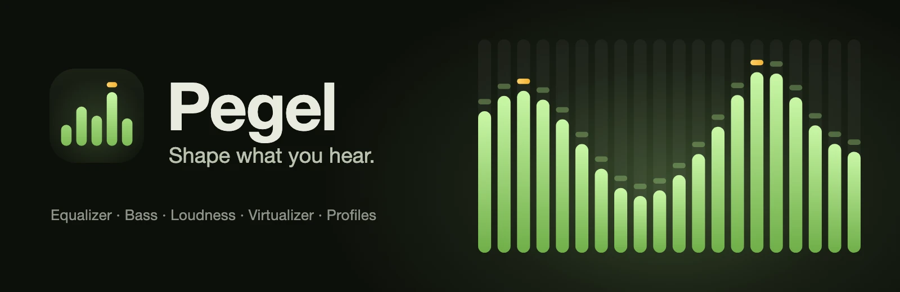
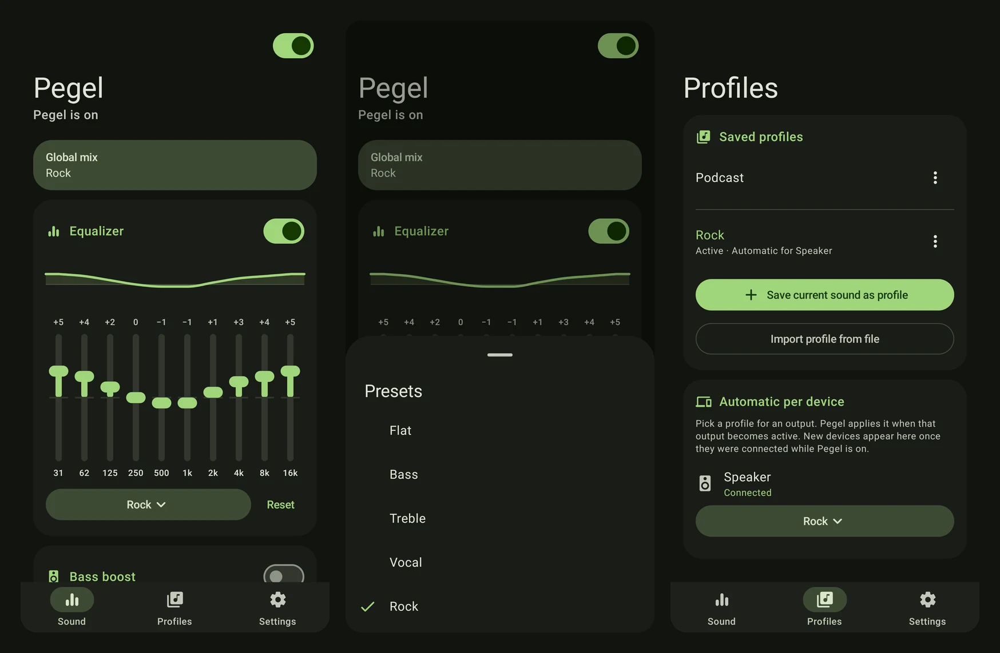
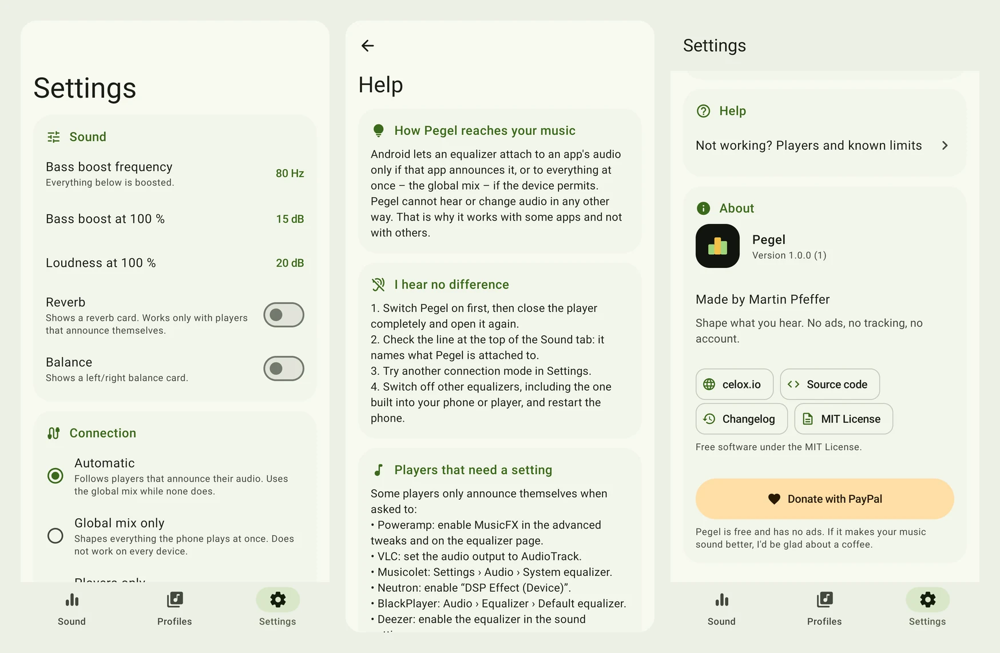

<div align="center">

<a href="https://github.com/pepperonas/pegel/releases/latest"></a>

# 🎚️ Pegel

**Shape what you hear.** — a system-wide equalizer for Android: ten bands, bass, loudness, virtualizer, and profiles that follow your headphones. Open source, no ads, no tracking.

<p>
  <a href="https://github.com/pepperonas/pegel/releases/latest"></a>
  &nbsp;
  <a href="https://www.paypal.com/donate/?business=martin.pfeffer@celox.io&currency_code=EUR&item_name=Pegel"></a>
</p>

<h3>👉 <a href="https://github.com/pepperonas/pegel/releases/latest">Releases</a> — always the newest signed APK, with checksums</h3>

<!-- Generated by scripts/update-badges.py — never edit these four by hand (ReadmeBadgesTest). -->
[](https://github.com/pepperonas/pegel/releases/latest)
[](app/src/test)
[](app/src/main/java)
[](app/src/test)

</div>

<!-- Project status -->
<p align="center">
  <a href="https://github.com/pepperonas/pegel/releases/latest"></a>
  <a href="https://github.com/pepperonas/pegel/releases/latest"></a>
  <a href="https://github.com/pepperonas/pegel/releases"></a>
  <a href="https://github.com/pepperonas/pegel/actions/workflows/tests.yml"></a>
  <a href="https://github.com/pepperonas/pegel/actions/workflows/release.yml"></a>
</p>
<p align="center">
  <a href="https://github.com/pepperonas/pegel/commits/main"></a>
  <a href="https://github.com/pepperonas/pegel/issues"></a>
  
  
</p>

<!-- Tech stack -->
<p align="center">
  
  
  
  
  
  
</p>
<p align="center">
  
  
  
  
  
</p>

<!-- Promises -->
<p align="center">
  
  
  
  
  
  
  <a href="LICENSE"></a>
  <a href="CHANGELOG.md"></a>
  
  <a href="https://www.paypal.com/donate/?business=martin.pfeffer@celox.io&currency_code=EUR&item_name=Pegel"></a>
</p>

**English** · [Deutsch](README.de.md)

Pegel attaches Android's own audio effects to the music you play and lets you shape it: a ten-band
equalizer, bass boost, loudness, a virtualizer, optional reverb and balance. Save the result as a
profile and bind it to an output — your earbuds get their sound the moment they connect.

## Screenshots

<p align="center">
  
</p>
<p align="center">
  
</p>

## Download

Get the newest signed APK from **[Releases](https://github.com/pepperonas/pegel/releases/latest)**. Each release carries a
`SHA256SUMS.txt`; compare it before installing:

```bash
sha256sum -c SHA256SUMS.txt
```

Pegel is not on Google Play. Android will ask you to allow installing from your browser or file
manager once.

## What it does

| | |
|---|---|
| **Equalizer** | Ten bands (31 Hz – 16 kHz), ±12 dB in 0.5 dB steps, a curve above the sliders, 13 presets, your own presets |
| **Bass boost** | Strength 0–100 %; cutoff 10–150 Hz and maximum 5–30 dB in Settings |
| **Loudness** | Strength 0–100 %; maximum 5–30 dB in Settings. A limiter keeps boosts from clipping |
| **Virtualizer** | Strength 0–100 % |
| **Reverb** | Small, medium, large room · medium, large hall · plate (optional card) |
| **Balance** | Left/right, with a reset (optional card) |
| **Profiles** | The whole sound under a name: load, save, rename, delete, discard changes |
| **Automatic per device** | A profile per output: speaker, wired, USB, each Bluetooth device |
| **Backup** | Everything in one JSON file; single profiles as `.pegel` files |

Everything is free. There is no "pro" version.

## How it works

Android offers an equalizer app exactly two ways to reach audio, and Pegel uses both:

1. **Players that announce themselves.** A music player can broadcast "I am playing on audio session
   42". Pegel then attaches its effects to that session. This is the reliable way.
2. **The global mix.** Effects can also be attached to session 0 — everything the phone plays, mixed.
   Whether that is allowed depends on the device.

*Settings › Connection* decides which is used: **Automatic** (players when there are any, the global
mix otherwise), **Global mix only**, or **Players only**. The line at the top of the Sound tab always
says what Pegel is attached to right now.

All effects of one session run in a single
[`DynamicsProcessing`](https://developer.android.com/reference/android/media/audiofx/DynamicsProcessing)
instance — the post-equalizer carries the ten bands, a pre-equalizer band the bass boost, the limiter
the loudness gain, the per-channel input gain the balance — plus Android's `Virtualizer` and
`PresetReverb`. Pegel does not capture, record or process audio itself; it only configures effects the
system runs.

## What works – and what doesn't

Pegel can only shape audio that reaches it one of the two ways above. That is a limit of Android, not
of this app, and no equalizer without root gets around it.

- **Works:** players that announce their session (many music players do, some need a setting — see
  the in-app help), and whatever your device lets through the global mix.
- **May need a setting in the player:** Poweramp, VLC, Musicolet, Neutron, BlackPlayer, Deezer. Look
  for "system equalizer" in the player's audio settings.
- **Does not work:** apps that neither announce their audio nor play through the global mix —
  typically apps with their own audio engine or copy protection.
- **Reverb** only works on a player's own session, not on the global mix. The card says so.
- **Bluetooth:** if the sound changes on the speaker but not over Bluetooth, turn on *Disable
  Bluetooth A2DP hardware offload* in the developer options and restart.
- **Other equalizers** (including the one built into your phone) fight over the same session. Use one.
- **Android 9 or newer.** `DynamicsProcessing` does not exist before that.

The app has a help page for all of this: *Settings › Help*.

## Profiles & devices

A profile is a snapshot of every card on the Sound tab. Change something and the profile shows
"(modified)" until you save or discard.

On the Profiles tab every output Pegel has seen gets a row: pick the profile it should use. When that
output becomes active, Pegel applies the profile and tells you in a short notification. Outputs are
recognised by kind and name — that needs no Bluetooth permission, at the price that two devices of the
same model share one entry.

## Backup

*Settings › Backup* writes all profiles, presets and settings into one JSON file through Android's file
picker, and reads it back. A restore replaces what is there (after asking) and never switches Pegel on
or off. A file that is damaged, foreign, or from a newer version is refused and changes nothing.

## Permissions

| Permission | Why |
|---|---|
| `MODIFY_AUDIO_SETTINGS` | Attach effects to the global mix |
| `FOREGROUND_SERVICE`, `FOREGROUND_SERVICE_SPECIAL_USE` | Keep the effects alive while Pegel is on |
| `POST_NOTIFICATIONS` | The notification of that service: what Pegel is attached to, and "turn off" |
| `RECEIVE_BOOT_COMPLETED` | Start again after a reboot, if Pegel was on |
| `REQUEST_IGNORE_BATTERY_OPTIMIZATIONS` | Offer the exemption in Settings, so the phone does not stop Pegel |
| `INTERNET` | Only the opt-in update check (off by default) |

No microphone, no storage, no Bluetooth, no location, no contacts.

## Privacy

Pegel has no ads, no analytics, no crash reporting and no account. Profiles and settings stay on the
phone. The app goes online for exactly one thing, and only if you switch it on: once a day it asks
GitHub's public API for the newest release tag — a plain request with no identifier.

## Building

```bash
git clone https://github.com/pepperonas/pegel.git && cd pegel
./gradlew :app:assembleDebug        # APK → app/build/outputs/apk/debug/
```

JDK 17 and the Android SDK (platform 35) are required; Android Studio creates `local.properties`.

### Tests

```bash
./gradlew :app:testDebugUnitTest    # JVM + Robolectric
./gradlew :app:lintDebug
```

The audio logic is plain Kotlin behind an interface (`EffectChain`), so the session routing, the
mapping from sliders to effect parameters, the profile store and the backup format are all tested
without a device. Drift guards keep the READMEs, the changelogs, the two languages and the permission
list honest.

## Project structure

```
app/src/main/java/io/celox/pegel/
  audio/      SoundState, presets, ChainPlan, EffectEngine — and AndroidEffectChain,
              the only file that touches android.media.audiofx
  data/       Room (profiles, presets, devices), DataStore settings, SoundRepository, backup format
  device/     output detection, per-device auto-apply
  service/    foreground service, session and boot receivers, notifications
  ui/         sound · profiles · settings · about · theme (Material 3 Expressive)
  update/     opt-in update check
```

## Creating a release

1. Bump `versionCode` and `versionName` in `app/build.gradle.kts`.
2. Add a dated `## [X.Y.Z] - YYYY-MM-DD` section to `CHANGELOG.md` **and** `CHANGELOG.de.md`.
3. `python3 scripts/update-badges.py`
4. Commit, push, then `git tag vX.Y.Z && git push origin vX.Y.Z`.

The workflow runs the tests, builds the signed APK, checks the signing certificate against the
repository variable `SIGNING_CERT_SHA256`, and publishes `pegel-vX.Y.Z.apk` with `SHA256SUMS.txt` and
the changelog section as release notes.

## Acknowledgements

The feature set was inspired by Flat Equalizer. Pegel is an independent implementation written against
Android's public audio effect API; it contains no code, texts or data from that app.

## License & support

[MIT](LICENSE). If Pegel makes your music sound better, I'd be glad about a
[coffee](https://www.paypal.com/donate/?business=martin.pfeffer@celox.io&currency_code=EUR&item_name=Pegel).

---

© 2026 Martin Pfeffer | [celox.io](https://celox.io)
